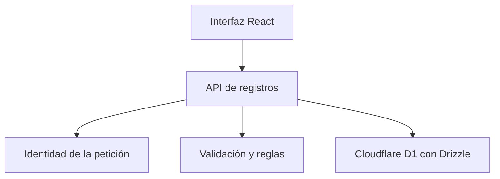

# Pulso

Dashboard personal para reunir agenda, finanzas, entrenamientos y tareas en una sola aplicación. El objetivo es reducir el esfuerzo de registrar el día a día y convertir esos registros en información útil para decidir qué hacer después.

**Autor · Jacobo Taboada Esteban**

**Estado · MVP funcional**

**Interfaz · Español, diseño adaptable a móvil y escritorio**

Este repositorio contiene una edición de demostración con datos ficticios. La aplicación personal original se utiliza con acceso privado. La demo local permite explorar los flujos sin conectar cuentas externas.

## Qué puedes hacer

| Área | Funciones disponibles |
| --- | --- |
| Inicio | Resumen del día, agenda semanal y tiempo libre restante hasta las 22:00, actualizado con la hora de Madrid. |
| Foco semanal | Meta de cuatro días de gimnasio, avances en TFG y Trabajo, historial por semana y cambio de semana cada lunes. |
| Finanzas | Registrar ingresos y gastos, consultar meses, categorías, presupuesto y previsión de gasto. |
| Inversiones | Consultar operaciones, posiciones abiertas, comisiones y resultado con precios de referencia editables. |
| Gimnasio | Crear rutinas, registrar pesos y repeticiones por serie, temporizador de descanso e historial de sesiones. |
| Tareas | Crear, editar y completar tareas con prioridad, fecha y vínculo opcional a un objetivo semanal. |
| Vida diaria | Eventos con recurrencia entre semana, vencimientos, suscripciones, hábitos y registros manuales de salud. |
| Citas | Selección diaria de una cita según actividad reciente y agenda, con autor y enlace a la fuente. |
| Exportación | Descargar los registros y la cartera de ejemplo en JSON. |

Las inversiones se muestran a partir de una colección inicial de operaciones. La conexión automática con Excel está pendiente. Los precios son manuales e ilustrativos. Las citas proceden de una selección fija con fuentes y se eligen mediante reglas; su selección no requiere un modelo de IA.

## Ejecutar la demo

Se necesita **Node.js 22.13 o posterior** y npm. Los scripts de pruebas usan el soporte de TypeScript de Node. Se recomienda Node 24, utilizado para validar esta versión.

```bash
git clone https://github.com/Jacobotaboadaesteban/pulso.git
cd pulso
npm ci
npm run db:migrate
npm run db:seed
npm run dev
```

Abre **http://127.0.0.1:5173**. La pantalla de acceso local crea una sesión ficticia mediante el adaptador de desarrollo. No requiere credenciales de GitHub, ChatGPT o Cloudflare. La base de datos local se guarda bajo `.wrangler/`, carpeta excluida de Git.

El comando de carga inserta ejemplos con la fecha actual y puede repetirse sin duplicar los mismos identificadores. Puedes crear tus propios registros desde la interfaz. El archivo `lib/investments.ts` contiene las cinco operaciones de ejemplo utilizadas por la cartera.

## Recorrido sugerido

1. Abre Inicio y consulta el entrenamiento de ejemplo y el avance del TFG.
2. Crea una tarea vinculada a Trabajo y complétala. El objetivo semanal reflejará ese avance.
3. En Gimnasio, crea una rutina y registra una sesión con algunas series completadas.
4. Añade un gasto en Finanzas y consulta el resumen mensual.
5. Exporta los datos desde Conexiones.

## Arquitectura



| Tecnología | Responsabilidad |
| --- | --- |
| React y TypeScript | Interfaz interactiva, estado y contratos de datos. |
| Vinext y Vite | Ejecución del modelo App Router y compilación para Cloudflare Workers. |
| Cloudflare Workers | Ejecución del servidor y de `/api/records`. |
| Cloudflare D1 | Persistencia de registros sobre SQLite. |
| Drizzle ORM | Consultas y esquema de la base de datos. |
| Zod | Validación de rutinas, sesiones, fechas y registros personales. |
| CSS y Lucide | Diseño adaptable, tema oscuro e iconos. |

El proyecto usa Vinext, una implementación del modelo de Next.js sobre Vite. El despliegue original se realiza en Sites sobre Cloudflare Workers y D1. Las instrucciones incluidas preparan una ejecución local sobre ese mismo modelo de servidor.

### Modelo de datos

La tabla `records` guarda `id`, `user_id`, `kind`, `data` y `created_at`. El campo `kind` identifica movimientos, tareas, entrenamientos, hábitos y otros registros. `data` almacena JSON validado por el servidor según el tipo.

Este modelo facilita incorporar módulos en un MVP. Sus siguientes necesidades de evolución son índices por usuario/tipo y tablas específicas si crecen las consultas analíticas o el volumen de registros.

### Decisiones de producto y reglas

- **Semana en Madrid.** Los cálculos usan `Europe/Madrid`; los límites semanales se determinan de lunes a domingo.
- **Constancia por días.** Dos sesiones en la misma fecha cuentan como un día de entrenamiento para la meta semanal.
- **Avances con fecha.** Completar una tarea vinculada o registrar un avance genera un registro fechado. El evento del calendario por sí solo no completa objetivos.
- **Historial conservado.** El reinicio semanal se calcula filtrando fechas; los registros anteriores siguen disponibles.
- **Una cita al día.** La primera selección se guarda por usuario y fecha, permanece estable durante ese día y evita repetir la última mostrada.
- **Guardado resistente a reintentos.** Los avances diarios y las citas usan identificadores deterministas para evitar duplicados. La tarea y su avance asociado se escriben en un lote de base de datos.
- **Borrador del entrenamiento.** Se conserva en el navegador mientras se prepara la sesión. Los entrenamientos finalizados se guardan en D1.

## Estructura del código

| Ruta | Contenido |
| --- | --- |
| `app/dashboard.tsx` | Navegación, finanzas, inversiones y tareas. |
| `app/life.tsx` | Panel de Inicio, agenda y registros personales. |
| `app/gym.tsx` | Rutinas, sesión activa, progresión e historial. |
| `app/weekly-focus.tsx` | Objetivos semanales e historial. |
| `app/api/records/route.ts` | API autenticada para consultar, guardar y eliminar registros. |
| `lib/life.ts` | Fechas, calendario, presupuestos y esquemas de validación. |
| `lib/gym.ts` | Validación y cálculos de entrenamiento. |
| `lib/focus.ts` | Recuento semanal y selección de citas. |
| `lib/investments.ts` | Operaciones y precios ficticios. |
| `db/` y `drizzle/` | Esquema ORM y migración SQL. |
| `scripts/` | Carga de ejemplos, comprobaciones y adaptador local. |

## Validación

```bash
npm run check
npm test
npm run build
npm run format:check
```

Las comprobaciones incluyen fechas inválidas, eventos solapados, límites de día, cambios de horario en Madrid, recurrencia de lunes a viernes, fin de mes en suscripciones, presupuesto, validación de series, volumen de entrenamiento, semanas históricas y rotación diaria de citas.

Para probar el acceso local, la persistencia y la edición mediante la API, deja `npm run dev` ejecutándose. En otra terminal:

```bash
npm run test:api
```

El script utiliza usuarios ficticios y elimina los registros de prueba que crea. Debe ejecutarse únicamente contra la instancia local de demostración.

## Acceso y despliegue

La API comprueba la identidad y filtra los registros por usuario. Las escrituras comprueban también el origen de la petición. El servidor original recibe la identidad de un proxy de confianza de Sites a través de cabeceras de autenticación.

El adaptador local simula esa identidad exclusivamente durante el desarrollo y para conexiones de loopback. Un despliegue público propio requiere configurar un proveedor de autenticación o un proxy de confianza que valide la sesión y elimine cabeceras aportadas por el visitante antes de establecer la identidad. Las cabeceras por sí solas no constituyen autenticación para un Worker expuesto a Internet.

`wrangler.jsonc` incluye un identificador ficticio para la base de datos local. Para desplegar una instancia propia, se necesita una base D1 real, migraciones y autenticación de producción. El repositorio no está configurado para publicar automáticamente.

## Estado y próximas mejoras

- [x] MVP con módulos de vida diaria, gimnasio y finanzas.
- [x] Persistencia, validación y objetivos semanales con historial.
- [x] Demo reproducible con datos ficticios y comandos de comprobación.
- [ ] Sincronización real con un Excel guardado en un servicio compatible.
- [ ] Importación de operaciones y reconciliación de datos financieros.
- [ ] Más componentes pequeños en los módulos principales y contratos de datos más específicos.
- [ ] Mayor cobertura de integración y accesibilidad.
- [ ] Adaptador de autenticación de producción independiente de Sites.

## Desarrollo

Proyecto personal de **Jacobo Taboada Esteban**, desarrollado de forma iterativa con asistencia de IA para implementación, revisión y pruebas. La evolución parte de necesidades de uso diario y de la revisión de los resultados en la aplicación.

El adaptador de Vite incluido conserva su licencia MIT original en `scripts/vite/sites-vite-plugin.LICENSE`. Las citas muestran sus fuentes y señalan las traducciones.
